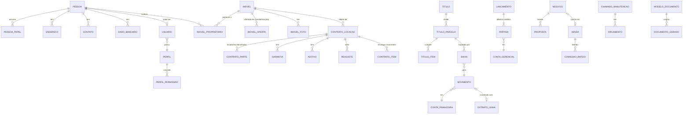

# STATUS ERP IMOBILIÁRIO — Modelo de Dados

> Convenções: chaves `id INTEGER PRIMARY KEY`; valores monetários `*_centavos INTEGER`; percentuais `*_bp INTEGER` (1% = 100 bp) ou `*_ppm` para índices econômicos; datas `TEXT` ISO-8601; competência `TEXT 'AAAA-MM'`; todas as tabelas de cadastro têm `criado_em, criado_por, atualizado_em, atualizado_por, excluido_em`. FKs com `ON DELETE RESTRICT`. `PRAGMA foreign_keys=ON`, `journal_mode=WAL`.

## 1. Mapa de relacionamentos (visão macro)

## 2. Segurança e núcleo

| Tabela | Campos principais | Observações |
|---|---|---|
| `usuario` | login (único), senha_hash, perfil_id, pessoa_id?, ativo, tentativas_falhas, bloqueado_ate, deve_trocar_senha, ultimo_acesso_em | pessoa_id liga o colaborador/corretor ao cadastro único |
| `perfil`, `permissao`, `perfil_permissao` | código da permissão `modulo.recurso.acao` | permissões semeadas por migração |
| `usuario_escopo` | usuario_id, tipo (`CARTEIRA_PROPRIA`, `TODOS`) | restringe corretor aos próprios registros |
| `auditoria` | ts, usuario_id, acao, entidade, entidade_id, antes_json, depois_json (redigidos), ip_estacao, hash_anterior, hash | append-only; triggers impedem UPDATE/DELETE |
| `configuracao` | chave, valor_json | dados da empresa, CRECI, parâmetros |
| `sequencia` | nome, prefixo, proximo | códigos de imóvel, contrato, recibo |
| `feriado` | data, descricao, abrangencia (nacional/municipal) | vencimentos em dia não útil |
| `anexo` | entidade, entidade_id, categoria, nome_original, caminho_relativo, mime, tamanho, sha256, cifrado | genérico para documentos e fotos |
| `outbox_evento` | tipo, payload_json, criado_em, processado_em | base para integrações futuras |
| `notificacao` | usuario_id, tipo, mensagem, referencia, lida_em | alertas locais (vencimentos, reajustes) |

## 3. Pessoas (cadastro único com papéis)

| Tabela | Campos principais |
|---|---|
| `pessoa` | tipo (PF/PJ), nome / razão social, nome_fantasia, cpf_cnpj (**único**, validado com dígito), rg_ie, orgao_emissor, nascimento, nacionalidade, estado_civil, regime_bens, profissao, situacao (ativo/inativo/bloqueado), observacoes, base_legal_lgpd |
| `pessoa_papel` | pessoa_id, papel (`PROPRIETARIO, LOCATARIO, FIADOR, COMPRADOR, VENDEDOR, CORRETOR, PRESTADOR, FORNECEDOR, COLABORADOR`), ativo, dados_json (ex.: CRECI do corretor, especialidade do prestador). **Único (pessoa_id, papel)** |
| `pessoa_relacao` | pessoa_id, relacionada_id, tipo (cônjuge, representante legal, sócio, procurador) |
| `endereco` | pessoa_id, tipo, cep, logradouro, numero, complemento, bairro, cidade, uf, principal |
| `contato` | pessoa_id, tipo (telefone/celular/e-mail/WhatsApp), valor, nome_contato, principal |
| `dado_bancario` | pessoa_id, banco_codigo, agencia, conta, digito, tipo_conta, chave_pix_tipo, chave_pix, titular_nome, titular_documento, principal — **campos cifrados + acesso por permissão** |

## 4. Imóveis

| Tabela | Campos principais |
|---|---|
| `imovel` | codigo (automático, único), tipo (casa, apto, sala, loja, galpão, terreno, rural…), finalidade (residencial/comercial/rural/mista), endereço completo, matricula + cartorio (únicos entre ativos), inscricao_municipal, area_construida / area_terreno (centésimos de m²), dormitorios, suites, banheiros, vagas, descricao_comercial, condominio_centavos, iptu_anual_centavos, corretor_responsavel_id, ativo |
| `imovel_proprietario` | imovel_id, pessoa_id, percentual_bp (**soma = 10.000**), principal, recebe_repasse, dado_bancario_id |
| `imovel_oferta` | imovel_id, modalidade (`VENDA`/`LOCACAO`), valor_centavos, comissao_bp, situacao (`DISPONIVEL, RESERVADO, EM_NEGOCIACAO, ALUGADO, VENDIDO, INDISPONIVEL, INATIVO`), desde. **Único (imovel_id, modalidade)** → mesmo imóvel em venda e locação com controles independentes |
| `oferta_situacao_hist` | oferta_id, de, para, motivo, usuario, ts |
| `caracteristica`, `imovel_caracteristica` | catálogo (piscina, elevador, mobiliado…) para busca |
| `imovel_foto` | imovel_id, anexo_id (único), miniatura_uuid, ordem, capa, legenda |

Regras de consistência (implementadas na Fase 2 — ver ADR-24): ao vender, a oferta de locação disponível passa automaticamente a `INATIVO`; ao alugar, a oferta de venda permanece (imóvel alugado pode ser vendido). Histórico de situação em `oferta_situacao_hist` (append-only).

## 5. Locações

| Tabela | Campos principais |
|---|---|
| `contrato_locacao` | numero, imovel_id, tipo (residencial/comercial/temporada), inicio, fim, prazo_meses, aluguel_centavos, dia_vencimento, indice_id, periodicidade_reajuste_meses, mes_base_reajuste, taxa_admin_bp, taxa_admin_base, taxa_intermediacao (regra do 1º aluguel), multa_atraso_bp, juros_mes_bp, desconto_pontualidade_bp, modalidade_repasse (`APOS_RECEBIMENTO`/`GARANTIDO`), prazo_repasse, situacao (`RASCUNHO, ATIVO, EM_RENOVACAO, ENCERRADO, RESCINDIDO`) |
| `contrato_parte` | contrato_id, pessoa_id, papel (`LOCADOR, LOCATARIO, FIADOR`), percentual_bp (para locadores) |
| `contrato_administracao` | imovel_id, proprietário(s), vigência, taxa, condições — o contrato da imobiliária com o dono |
| `garantia` | contrato_id, tipo (`CAUCAO, FIANCA, SEGURO_FIANCA, TITULO_CAPITALIZACAO, SEM_GARANTIA`), valor, seguradora, apolice, vigência, fiador_id, conta_deposito_id |
| `contrato_item` | contrato_id, tipo (aluguel, condomínio, IPTU, seguro incêndio, despesa, desconto, outros), valor, competencia_ini/fim, parcelas, **pagador** (locatário/proprietário/imobiliária), **beneficiário** (proprietário/imobiliária/terceiro), repassa (s/n), incide_taxa_admin (s/n) |
| `aditivo` | contrato_id, tipo (renovação, alteração de valor/prazo/partes, outros), vigência, alteracoes_json, documento_id |
| `indice_economico`, `indice_valor` | sigla (IGP-M, IPCA, INPC, IVAR), competencia, variacao_ppm — **digitado/importado manualmente** (offline) |
| `reajuste` | contrato_id, competencia, indice, acumulado_ppm, valor_anterior, valor_novo, aplicado_por, aplicado_em |
| `rescisao` | contrato_id, data, motivo, iniciativa, multa_calculada, memória_calculo_json, aprovado_por |
| `vistoria`, `vistoria_ambiente`, `vistoria_item` | tipo (entrada/saída/periódica), data, vistoriador, ambiente, item, estado, observação, fotos (anexo) |

A **cobrança mensal** e o **repasse** não são tabelas isoladas: são `titulo`s do financeiro com `origem = CONTRATO_LOCACAO` e chave de idempotência `LOC:{contrato}:{competencia}:COBRANCA` / `…:REPASSE:{proprietario}`.

## 6. Financeiro

### 6.1 Títulos (o "a receber / a pagar")

| Tabela | Campos principais |
|---|---|
| `titulo` | sentido (`RECEBER`/`PAGAR`), origem_tipo, origem_id, pessoa_id, descricao, competencia, emissao, **recurso (`PROPRIO`/`TERCEIROS`)**, situacao (`ABERTO, PARCIAL, LIQUIDADO, CANCELADO, RENEGOCIADO`), chave_idempotencia (**única**) |
| `titulo_parcela` | titulo_id, numero, vencimento, valor_centavos, situacao |
| `titulo_item` | parcela_id, conta_gerencial_id, descricao, valor_centavos, beneficiario_pessoa_id (ex.: proprietário) ou "imobiliária", incide_taxa_admin |
| `baixa` | parcela_id, data_pagamento, principal, juros, multa, desconto, total, conta_financeira_id, forma (PIX, boleto, TED, dinheiro…), movimento_id, estorno_de_id, motivo_estorno |
| `renegociacao` | titulos_origem (N), titulo_novo, condicoes_json, aprovado_por |

**Situação do título é derivada das baixas** (soma das baixas não estornadas × valor). Emitir cobrança ≠ receber.

### 6.2 Tesouraria

| Tabela | Campos principais |
|---|---|
| `conta_financeira` | nome, tipo (caixa/conta corrente/aplicação), banco, agência, conta, **titularidade (`PROPRIO`/`TERCEIROS`)**, saldo_inicial, data_saldo_inicial, ativa |
| `movimento` | conta_financeira_id, data, valor_centavos (com sinal), tipo (entrada/saída/transferência), historico, transferencia_par_id, conciliado, estorno_de_id |
| `extrato_importacao` | conta_id, formato (OFX/CSV), periodo, sha256_arquivo (**único por conta** → impede importar duas vezes) |
| `extrato_linha` | importacao_id, data, valor, fitid (**único por conta**), descricao, movimento_id (conciliação) |

### 6.3 Razão gerencial (partidas dobradas simplificadas)

| Tabela | Campos principais |
|---|---|
| `conta_gerencial` | codigo, nome, natureza (`ATIVO, PASSIVO, RECEITA, DESPESA`), pai_id, aceita_lancamento, recurso (próprio/terceiros) |
| `lancamento` | data, competencia, historico, origem_tipo, origem_id, estorno_de_id |
| `partida` | lancamento_id, conta_gerencial_id, pessoa_id (subconta: qual proprietário), debito_centavos, credito_centavos |

Invariante validada em código e por verificação periódica: **Σ débitos = Σ créditos** em cada lançamento.

O usuário **não vê** partidas dobradas no dia a dia — ele trabalha com títulos, baixas e repasses. O razão é gerado automaticamente e garante que relatórios (saldo de terceiros, receita própria, resultado) sejam consistentes e auditáveis.

### 6.4 Exemplo — ciclo de um aluguel

Contrato: aluguel R$ 2.000,00; condomínio cobrado junto R$ 500,00 (a imobiliária paga ao condomínio); taxa de administração 10% sobre aluguel; locatário paga com 5 dias de atraso: multa 10% (R$ 200,00) + juros 1% a.m. pro rata (R$ 3,33).

| Evento | Débito | Crédito | Valor |
|---|---|---|---|
| 1. Emissão da cobrança | — (apenas título a receber; **nenhum efeito de caixa ou receita**) | | |
| 2. Recebimento R$ 2.703,33 | Banco Terceiros | Proprietário X a repassar | 2.000,00 |
| | Banco Terceiros | Condomínio a pagar | 500,00 |
| | Banco Terceiros | Proprietário X a repassar *(ou receita própria — Q5)* | 203,33 |
| 3. Apropriação da taxa | Proprietário X a repassar | Receita – Taxa de administração | 200,00 |
| 4. Transferência da taxa | Banco Próprio | Banco Terceiros | 200,00 |
| 5. Pagamento do repasse | Proprietário X a repassar | Banco Terceiros | 2.003,33 |
| 6. Pagamento do condomínio | Condomínio a pagar | Banco Terceiros | 500,00 |

Resultado: apenas R$ 200,00 viram receita da imobiliária; todo o resto transita como recurso de terceiros, com saldo rastreável por proprietário.

## 7. Vendas e CRM

| Tabela | Campos principais |
|---|---|
| `lead` | pessoa_id?, nome, telefone, e-mail, origem_id, corretor_id, interesse (compra/locação), perfil_busca_json (tipo, bairros, faixa de preço, dormitórios), situacao |
| `origem_lead` | indicação, placa, portal X, site, Instagram, WhatsApp… |
| `negocio` | tipo (`VENDA`/`LOCACAO`), lead_id/pessoa_id, imovel_id?, corretor_id, **etapa** (`CAPTACAO, ATENDIMENTO, VISITA, PROPOSTA, NEGOCIACAO, CONTRATO, CONCLUIDO, PERDIDO`), valor_estimado, motivo_perda |
| `negocio_etapa_hist` | negocio_id, de, para, ts, usuario (base dos indicadores de conversão) |
| `atividade` | negocio_id/lead_id, responsavel_id, tipo (ligação, visita, e-mail, tarefa), agendada_para, concluida_em, resultado |
| `visita` | imovel_id, pessoa_id, corretor_id, data_hora, situacao, feedback |
| `proposta` | negocio_id, versao, proposta_anterior_id (contraproposta), autor (comprador/vendedor), valor, sinal, parcelas_json, financiamento (banco, valor, situação), validade, situacao |
| `venda` | negocio_id, imovel_id, data_contrato, valor, situacao (`CONTRATADA, AGUARDANDO_FINANCIAMENTO, ESCRITURADA, CONCLUIDA, DISTRATADA`) |
| `venda_parte` | venda_id, pessoa_id, papel (comprador/vendedor), percentual |
| `comissao` | origem (venda/locação), base_centavos, percentual_bp, valor_total, situacao |
| `comissao_rateio` | comissao_id, beneficiario (corretor/imobiliária/parceiro), papel (captador, vendedor, gerente, parceiro), percentual_bp, valor, titulo_pagar_id |

Comissão gera **título a receber** (do vendedor/comprador) e, **somente após o recebimento** (regra a confirmar — Q14), **títulos a pagar** aos corretores conforme rateio.

## 8. Documentos

| Tabela | Campos principais |
|---|---|
| `modelo_documento` | codigo, nome, categoria, versao, conteudo_json (TipTap), situacao (`RASCUNHO, EM_REVISAO_JURIDICA, APROVADO, OBSOLETO`), aprovado_por, aprovado_em |
| `documento_gerado` | modelo_id, modelo_versao, entidade, entidade_id, conteudo_final_json, pdf_anexo_id, docx_anexo_id, sha256, gerado_por, gerado_em |

Variáveis dinâmicas tipadas (`{{locatario.nome}}`, `{{contrato.aluguel_extenso}}`, `{{imovel.matricula}}`…) definidas em código, com validação de variáveis ausentes antes da geração. Só modelos `APROVADO` geram documentos definitivos; rascunhos saem com marca d'água "MINUTA".

## 9. Manutenção

| Tabela | Campos principais |
|---|---|
| `chamado_manutencao` | imovel_id, contrato_id?, solicitante_id, descricao, prioridade, situacao (`ABERTO, ORCAMENTO, AGUARDANDO_APROVACAO, APROVADO, EM_EXECUCAO, CONCLUIDO, CANCELADO`), responsavel_custo (locatário/proprietário/imobiliária) |
| `orcamento` | chamado_id, prestador_id, valor, prazo, anexo_id, selecionado |
| `aprovacao_manutencao` | chamado_id, orcamento_id, aprovador_pessoa_id, forma (presencial, e-mail, WhatsApp), data, evidencia_anexo_id |
| `chamado_evento` | chamado_id, ts, descricao, usuario, fotos |

Ao concluir: gera título a pagar ao prestador e, conforme responsável pelo custo, **item de desconto no próximo repasse** ou **item na próxima cobrança do locatário**.

## 10. Backup

| Tabela | Campos principais |
|---|---|
| `backup_registro` | ts, tipo (manual/automático/pré-restauração), destino, arquivo, tamanho, sha256, versao_app, versao_schema, validado, resultado, usuario_id |
